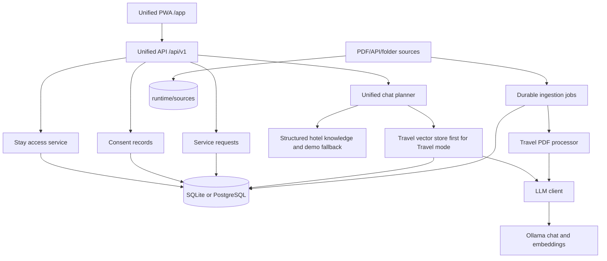
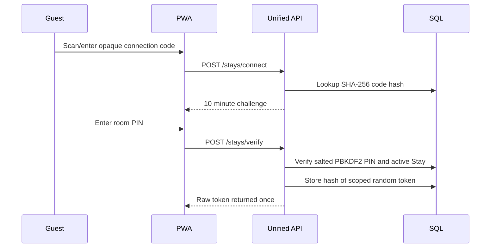
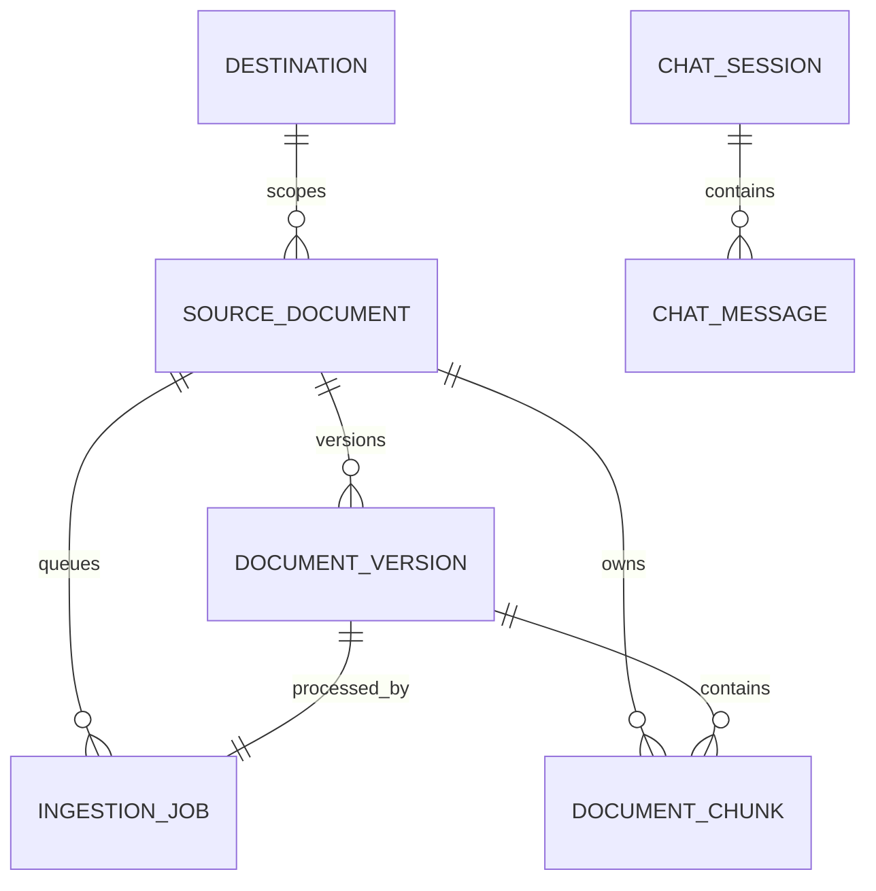

# Architecture

## Isolated proactive research boundary

`/api/v1/proactive` and `app/services/proactive/` add C01-F1.0 as an optional
session experiment. `proactive_sessions` stores hashed research credentials,
revision-guarded mode/consent, outbox, cached question transaction and actual
message receipts. `proactive_audits` stores pseudonymous decision records.
Alembic revision `20260911_0004` explicitly adds these two tables. No unified or
Travel table changes are required. The frontend uses the existing message
renderer through `app/static/pwa/scripts/proactive-recommendations.js`. The reactive SSE path remains
independent. See [integration status](PROACTIVE_INTEGRATION_STATUS.md) for data
provenance, delivery semantics, privacy, and real-data readiness limits.

## System overview

VietSage is a FastAPI modular monolith with a primary unified product surface,
a durable Travel RAG subsystem, and a disabled legacy Hotel subsystem.



The unified Hotel mode does not use the legacy Chroma store. Legacy Hotel code
is imported only when `HOTEL_MODE_ENABLED=true`.

## Application assembly

`app/main.py` is the runtime entry point. Startup performs:

1. verify that the configured database is at the single Alembic head; startup
   does not create primary tables or Travel search indexes;
2. initial destination seeding;
3. optional synthetic unified Hotel seeding in non-production;
4. shared Ollama HTTP client startup and optional warmup;
5. optional durable ingestion worker startup.

The public runtime label comes from explicit `BAYAH_DATA_MODE` configuration
and defaults to `real`; `demo` is intended for `scripts/run_demo.ps1`, which
uses an isolated SQLite database and `data/demo/runtime/sources`. Synthetic PDF
chunks retain non-authoritative provenance metadata, and a broad real-data scan
does not recurse into `data/demo` unless that root is selected explicitly.

Primary routes:

- `/`, `/app`: unified PWA;
- `/api/v1/*`: unified stay, chat, service, and privacy API;
- `/api/chat*`: existing Travel RAG API;
- `/chat-ui`: older Travel-only UI;
- legacy Hotel API/UI: feature-flagged compatibility path.

## Unified domain

### Authorization boundary



`preferred_mode` and UI tabs are presentation state only. Every Hotel operation
revalidates `X-Stay-Token`, expiry, stay status, and required scope.

### Unified conversation

Browser identity is represented by `AppSession`, which can be guest
(`user_id=NULL`) or authenticated. The browser holds only an opaque HttpOnly
cookie; SQL stores its SHA-256 hash. Unsafe conversation/account requests also
require a session-derived CSRF header kept only in JavaScript memory. Login and
signup rotate the token and transactionally promote only conversations owned by
the prior guest session.

`User`, `PasswordCredential`, and `OAuthIdentity` separate profile, local
credential and external identity data. Google identities are keyed by `(google,
sub)` and are never linked merely because an email matches. Account identity
does not replace `StayAccessGrant`; Hotel authorization remains a separate
scoped capability.

`UnifiedConversation` stores country, destination, active stay, preferred mode,
locale, and activity timestamps. `UnifiedMessage` stores each turn with the
context used to generate it.

The chat planner evaluates in this order:

1. validate Hotel access when Hotel mode is requested;
2. resolve explicit service-request phrases into an action draft;
3. for Travel mode, query the durable Travel RAG path;
4. when Travel retrieval is empty or unavailable, answer from public demo
   nearby-place knowledge; in Hotel mode, answer from structured non-travel
   hotel knowledge, then use the existing hotel context fallback if LLM
   generation is needed;
5. use Ollama for grounded generation when deterministic data is insufficient;
6. persist the completed turn.

For tour cancellation/refund/rescheduling questions, Travel retrieval uses
separate `Policy` chunks from the active PDF version. The JSON/SSE Travel API
and unified Travel planner use a deterministic source-faithful reply, without
LLM paraphrase. A generic question asks the guest to confirm the tour before
quoting; a named tour requires complete source/document/version provenance.
Missing or mixed evidence fails closed. Existing PDF versions need reingestion
with `travel-tour-v2-policy` to expose these chunks.

SSE contract:

- `token`: incremental model output;
- `replace`: deterministic or corrected final content;
- `action`: non-executed service request draft;
- `sources`: supporting source records;
- `done`: successful completion and resolved context;
- `error`: failure after the stream has opened.

The primary unified PWA intentionally does not render the `sources` event or a
technical context badge. It keeps service action and confirmation controls, and
maps stored system errors to the selected locale's friendly retry copy.

### Controlled Generative UI boundary

Travel itinerary generation is a structured branch inside the unified chat
planner. `response_registry.py` selects the registered context; only
`travel_itinerary` currently enables an artifact renderer. The model receives a
small grounded context and a schema, then `generative_ui.py` assigns stable IDs,
removes ungrounded coordinates or `mapUrl`, and validates the public artifact.

An edit receives the validated `currentArtifact` request field. The model can
return only ID-based `replace`, `add`, `remove`, or `move` operations. The public
JSON uses camelCase aliases, including `responseMode`, `mapUrl`, `toDayId`, and
`toIndex`. The server copies the artifact, applies every operation, revalidates
all invariants, and increments `version` as one transaction. A
`GENERATIVE_UI` action is emitted through the existing SSE `action` event; it
never submits a Hotel service request. Empty grounding, invalid JSON, stale
input, and provider errors retain the text fallback. No external map, places,
route, or image provider is part of the MVP. Detailed deliverables and pending
UI/performance verification are in [GENERATIVE_UI_DESIGN.md](GENERATIVE_UI_DESIGN.md).

### Service requests

Chat and service cards produce drafts only. Submission requires:

- an active token with `service:create`;
- a service belonging to the stay's hotel;
- explicit `confirmed=true` when required;
- a caller-provided idempotency key.

The unique `(stay_id, idempotency_key)` constraint converts network retries into
the original response rather than duplicate operational requests.

### Consent foundation

Consent is recorded per conversation and purpose with status, policy version,
source, recorded time, and withdrawal time. Current consent controls prepare for
future proactive work but do not activate geolocation, push, profiling, or
notifications.

## Durable Travel RAG

### Knowledge model



- `SourceDocument` is stable across source revisions.
- `DocumentVersion` is immutable for one content/pipeline identity.
- `IngestionJob` is retryable and durable.
- `DocumentChunk` stores text, metadata, and an embedding.
- Only a successfully completed version becomes active.

### Ingestion flow

```text
discover/upload PDF
-> map destination
-> calculate source hash
-> store immutable raw copy
-> create/reuse source and version
-> claim job
-> assign claim token and renew heartbeat during parse/embed
-> parse and split sections
-> embed with Ollama
-> insert chunks
-> fence by current claim token and atomically activate new version
```

Failure leaves the previous active version available. PostgreSQL uses
`FOR UPDATE SKIP LOCKED`; SQLite claims with one conditional `UPDATE ...
RETURNING` transaction (SQLite 3.35+), so two claimers cannot take the same
pending job. Revision `20260923_0009` adds a bounded lease: stale processing
work can be reclaimed until the attempt cap, while a claim token fences the old
worker from committing after ownership changes. An exhausted stale job becomes
`failed` instead of remaining stuck.

### Demo and real-data boundary

The fictional `data/demo/corpus` PDF uses the same parser, durable version,
queue, and chunk tables as other Travel sources, while its runtime state is
isolated under `data/demo/runtime/`. `BAYAH_DATA_MODE=demo` is an explicit
process setting; `real` is the default and production responses report `real`
even if a conflicting value is supplied. Broad real-data discovery skips the
demo tree, and a demo-tagged source outside the resolved `data/demo` root is
rejected before a storage copy is made. Chunk metadata keeps the demo
provenance, synthetic flag, non-authoritative authority, and dataset ID.

The demo launcher is `scripts/run_demo.ps1`. It migrates and owns
`data/demo/runtime/vietsage-demo-v2.db` plus the demo raw source directory;
the earlier unversioned `vietsage-demo.db` is preserved. It serves the same
PWA/API on loopback and does not alter the real-data `.env`, database, or source
storage. The banner in the PWA is driven
by `GET /api/info`, so a URL or query parameter cannot claim demo mode.

### Retrieval

- SQLite loads active scoped JSON embeddings and ranks them in Python, while
  exact keyword candidates and embedding-outage fallback come from FTS5.
- PostgreSQL combines pgvector nearest-neighbor results with PostgreSQL FTS.
- Query embeddings use a bounded in-memory cache keyed by exact model input.
- Exact normalized duplicates are removed after ranking.

Policy intent is detected separately in Vietnamese, English, and Simplified
Chinese. Policy and itinerary chunks are not mixed in a response. A policy
reply quotes extracted PDF wording from one verified active document version,
with its source filename; it does not use the generative chat provider.

Revision `20260923_0010` backfills the SQLite FTS table and maintains it through
insert/update/delete triggers. PostgreSQL keyword retrieval uses the GIN index.

## Persistence and migrations

SQLite supports local/demo use. PostgreSQL 17 with pgvector is the intended
production backend.

Migration chain:

```text
20260817_0001 bounded baseline
-> 20260817_0002 Travel session tables
-> 20260911_0003 unified stay/privacy/service MVP
-> 20260911_0004 proactive research sessions
-> 20260922_0005 account identity, opaque sessions and conversation ownership
-> 20260922_0006 message feedback
-> 20260923_0007 PostgreSQL HNSW index
-> 20260923_0008 SQLite Travel FTS5 / PostgreSQL search GIN index
-> 20260923_0009 ingestion claim leases and heartbeat index
-> 20260923_0010 SQLite Travel FTS backfill and synchronization triggers
-> 20260923_0011 legacy Hotel schema (content_hash, Hotel FTS5) moved out of startup
-> 20260923_0012 per-stay PINs and reception's PIN-lockout unlock
-> 20260924_0013 partner API keys and partner-owned conversations
```

Revision 0001 no longer calls live `Base.metadata.create_all()`. Runtime startup
now checks the Alembic revision and fails with upgrade instructions when it is
missing or outdated. Primary Travel schema/search DDL is owned by revisions;
the disabled legacy Hotel mode retains conditional SQLite compatibility helpers.
The local SQLite database was backed up and upgraded from 0005 to 0008 on
2026-09-23; a copied unversioned demo database could not be upgraded directly,
so the launcher uses a new migrated file. Revisions 0005 and 0006 are
adoption-safe: a database left at 0004 whose tables the old `create_all()`
already made (typically by starting the online launcher, which did not
migrate) upgrades cleanly instead of failing on "table already exists". PostgreSQL 18.6 + pgvector 0.8.1 was
verified on a disposable database; the PostgreSQL 17 CI job and deployed
database upgrade remain unobserved.

## PWA architecture

The primary PWA remains dependency-free and requires no frontend build step.
`app/static/pwa/index.html` is the semantic shell; `pwa/styles/` owns three ordered
CSS layers and `pwa/scripts/` owns native ES modules for content,
Markdown, streaming, Generative UI, and application orchestration. FastAPI
serves only an explicit `/app-assets/{asset_path}` allowlist. Product-owned
brand and Explore media live under `pwa/assets/`; compatibility pages are
isolated under `app/static/legacy/`.

The application module stores the separate raw stay token, conversation ID,
mode, and rendered chat in `sessionStorage`, so state is limited to the browser
tab. It does not persist the PIN. Account session tokens are HttpOnly cookies;
neither account tokens nor CSRF tokens are written to Web Storage.

The service worker is network-first and excludes `/api/`; sensitive stay/API
responses are never placed in its application-shell cache.

## Legacy Hotel path

Legacy files use `HotelDocument`, `ServiceMention`, ChromaDB, Hotel SQLite FTS,
and an in-memory `SessionStore`. They are not part of the unified product and
must not receive new features. Their presence explains the remaining Chroma
dependency.

## External systems

- Ollama REST for chat and embeddings.
- SQLite for local/demo persistence.
- PostgreSQL/pgvector for production-oriented persistence and retrieval.
- Cloudflare Tunnel for optional local HTTPS exposure.
- Google Compute Engine Compose deployment.
- PMS, payment, push, and staff systems are not integrated yet.

## Known architectural risks

- Public job/version reads and shared rate limits remain incomplete; admin
  mutations and source path containment are fixed locally.
- Primary schema drift now fails startup; legacy Hotel SQLite compatibility DDL
  remains conditional on its disabled feature flag.
- Unified message persistence is not serialized per conversation.
- Structured Hotel knowledge is separate from the versioned Travel knowledge
  pipeline.
- Production onboarding, staff workflow, PMS, and payment adapters are absent.
- SQLite vector retrieval remains linear; keyword retrieval is indexed. Job
  claiming is atomic and crash-stuck work has a fenced lease locally, pending
  PostgreSQL worker-death verification.
- The Travel grounding contract still has a prompt/validator mismatch.

See [TECHNICAL_DEBT.md](TECHNICAL_DEBT.md) and
[NEXT_STEPS.md](NEXT_STEPS.md).
